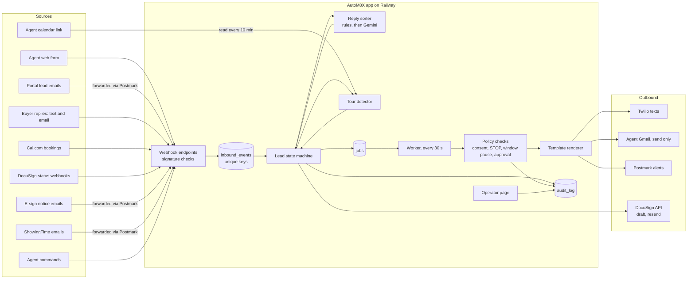
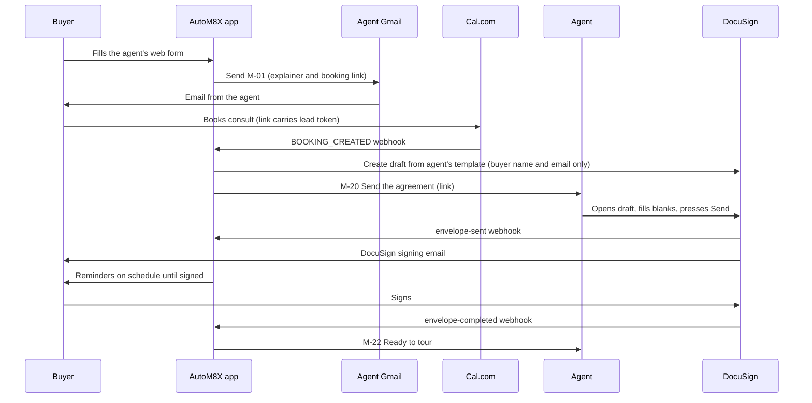
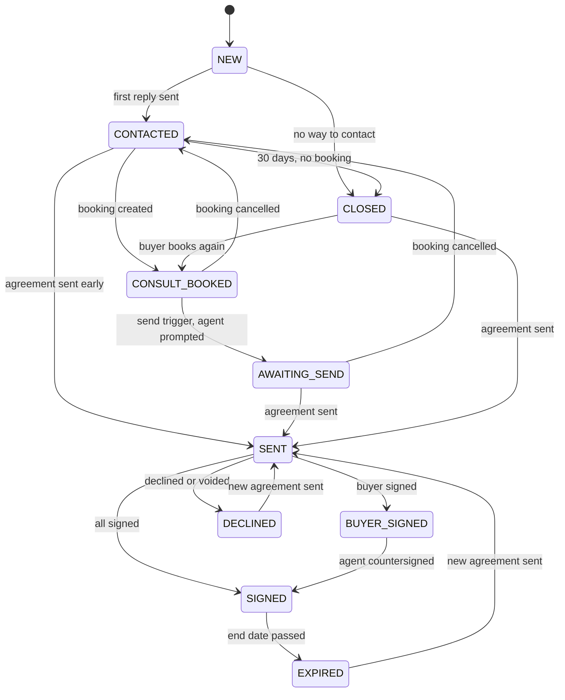

# Architecture: AutoM8X Buyer Agreement Agent (v1)

Version 0.1, 2026-10-16. Status: draft, not approved.

This design assumes the Python core (D-01). [Depends on Q1 to Q3] If you pick n8n, sections 6 to 8 (state machine, idempotency, reminder rules) still hold as rules, but the build changes.

Tags: [Lawyer], [Unverified], [Depends on Qn]. IDs in this file: C (components), ST (states), FL (flags), EV (events), TM (timers), T (transitions), DL (duplicate and late rules), IP (idempotency), RR (reminder rules), RS (reply sorting), TD (tour detection), ES (e-sign), EM (email), SMS, AL (alerts), AU (audit), SEC (secrets), AG (agent grants), RV (revoke), SC (security controls), OPS, ENV, COST, S (spikes).

---

## 1. Summary

One small Python web app, one background worker, and one Postgres database, hosted on Railway in the US. The app receives events (new leads, buyer replies, bookings, e-sign updates, tour emails), keeps one record per buyer lead, moves it through a fixed set of states, and sends only approved templates. Twilio sends texts. The agent's own Gmail sends buyer emails. Postmark receives forwarded emails and sends alerts. DocuSign is the first e-sign integration. Gemini only sorts buyer replies into five labels.

## 2. Stack

| Job | Choice | Why | Kept in reserve |
|---|---|---|---|
| Core app | Python 3.11+, FastAPI | Testable, you have used it before | n8n (D-01) |
| Database | Supabase (hosted Postgres), `app` schema (D-33) | Row locks, unique keys, safe job claiming | SQLite (no row locks for two processes) |
| Timers | Jobs table plus a worker loop every 30 s | One less service; easy to test with a fake clock | Celery and Redis |
| Hosting | Railway, US region | You planned Railway; simple deploys | Render, Fly.io |
| Texts | Twilio, a sub-account per agent | Per-agent numbers and billing, built-in STOP handling | None needed |
| Buyer email | Gmail API, send-only access, as the agent | Real "from the agent" email; send-only needs no paid audit | Microsoft Graph in v2 |
| Inbound email and alerts | Postmark (Pro) | Parses forwarded email to JSON; sends alert email | Cloudflare Email Workers |
| Booking | Cal.com webhooks; Calendly adapter | Lead token passes through the booking link | Calendly |
| E-sign | DocuSign API; others by email and commands | DocuSign is the only one of the three with an open signing API | None |
| Calendar | The agent's private iCal link, read every 10 min | Read-only, no app review, easy to revoke | Google Calendar API |
| Reply sorter | Gemini API (paid tier), `gemini-3.1-flash-lite`, fixed JSON output | Your choice (D-31); under $0.10 a month per agent | `gemini-3.8-flash` |
| Errors and uptime | Sentry, an uptime monitor | Know about failures before agents do | Railway logs only |
| Tests | pytest, time-machine (fake clock), respx (HTTP mocks) | Unit and integration tests without real services | None |

Main Python packages: fastapi, uvicorn, sqlalchemy, alembic, psycopg, pydantic, google-genai, twilio, google-api-python-client, google-auth-oauthlib, docusign-esign, icalendar, phonenumbers, httpx, jinja2, pyotp, cryptography.

## 3. Components

- **C-1. Web API.** Webhook endpoints, the demo form, confirm pages, the unsubscribe page, the operator page.
- **C-2. Intake adapters.** The web form handler and lead-email parsers (Zillow first, others as pilots need them).
- **C-3. Event store.** Every inbound event is saved once, by a unique key, before any processing.
- **C-4. Lead state machine.** The only code allowed to change a lead's state.
- **C-5. Policy checks.** Consent, opt-out, window, pause, approval, test-mode allowlist. Every send passes through here.
- **C-6. Template renderer.** Approved versions only, a fixed list of fill-in fields, fails closed.
- **C-7. Scheduler and worker.** Claims due jobs, runs them, re-checks state before any send.
- **C-8. Outbound adapters.** Twilio texts, Gmail send, Postmark alerts, optional Twilio voice call.
- **C-9. Reply sorter.** Fixed opt-out rules, then Gemini.
- **C-10. E-sign adapters.** DocuSign API, notice-email parsers, manual commands.
- **C-11. Booking adapters.** Cal.com, Calendly.
- **C-12. Tour detector.** ShowingTime parser, calendar reader, matcher.
- **C-13. Alert service.** Alerts, escalation, morning list, weekly summary.
- **C-14. Audit log.** Append-only record of everything.
- **C-15. Config loader.** Per-agent config plus secrets, validated on load.
- **C-16. Operator page.** Health, leads, timelines, approvals, pause switches.

## 4. Data flow



Happy path, DocuSign agent:



## 5. Data model

| Table | Holds | Key fields |
|---|---|---|
| agents | One row per agent | id, status (test, live, paused), config_version, timezone |
| agent_config_versions | Validated config snapshots | agent_id, version, body, valid, created_at |
| leads | One buyer for one agent | id, agent_id, token, name, email, phone_e164, zip, tz, state, opted_out_at, reminders_paused, created_at, last_activity_at |
| consent_events | Consent log, append-only | lead_id, channel, basis, captured_at, wording_version, evidence_ref, revoked_at, revoke_method |
| suppression | Opt-outs that outlive lead data | agent_id, contact_hash, channel, created_at |
| inbound_events | Every webhook, email and poll result | id, event_key (unique), source, received_at, payload_ref, processed_at, lead_id |
| outbound_messages | Every message we try to send | id, dedupe_key (unique), lead_id, template_id, template_version, channel, status, provider_id, body_masked, sent_at |
| jobs | Timers | id, job_key (unique), kind, lead_id, run_at, status, attempts, locked_until |
| bookings | Consults | lead_id, provider, provider_uid, start_at, end_at, status, provider_updated_at |
| agreements | Envelopes or manual records | lead_id, tool, envelope_id, status, status_rank, sent_at, buyer_signed_at, completed_at, end_date |
| tour_signals | Tours seen | id, agent_id, source, start_at, address, buyer_name_raw, lead_id, confidence, alert_id |
| alerts | Alerts to agents | id, agent_id, lead_id, kind, urgency, sent_at, ack_at, escalation_level |
| template_versions | Message texts | template_id, version, channel, body, sha256 |
| template_approvals | Who approved what | agent_id, template_id, version, approved_at, method, approver |
| form_confirmations | Form checklist records | agent_id, items, confirmed_at, method |
| sorter_runs | AI calls | lead_id, input_masked, label, possible_opt_out, model, prompt_version, latency_ms |
| oauth_tokens | Encrypted access tokens | agent_id, provider, ciphertext, expires_at |
| audit_log | Append-only record | id, at, agent_id, lead_id, actor_type, actor_id, action, details, trigger_event_id |

All times are stored in UTC.

## 6. State machine for one buyer lead

### 6.1 States

| ID | State | Meaning |
|---|---|---|
| ST-1 | NEW | Record created. First reply not sent yet (for example, waiting for the text window). |
| ST-2 | CONTACTED | First reply sent. Waiting for a consult booking. |
| ST-3 | CONSULT_BOOKED | Consult booked. Send trigger not fired yet. |
| ST-4 | AWAITING_SEND | Agent prompted to send the agreement. Not sent yet. |
| ST-5 | SENT | Agreement sent. Reminders running. |
| ST-6 | BUYER_SIGNED | Buyer signed, agent has not countersigned. |
| ST-7 | SIGNED | Every party signed. Ready to tour until the end date. |
| ST-8 | EXPIRED | The agreement's end date passed. Counts as unsigned. |
| ST-9 | DECLINED | Buyer declined, or the envelope was voided. |
| ST-10 | CLOSED | Stale, lost, or no way to contact. |

### 6.2 Flags

Flags sit beside the state. They never change the state.

- **FL-1. opted_out.** Set by any opt-out. Blocks every buyer message on every channel. Agent alerts about this buyer still work.
- **FL-2. reminders_paused.** Set by a legal question or the agent's PAUSE. Blocks reminders and nudges only.
- **FL-3. sms_allowed.** Computed: consent record, agent registration approved, lawyer gate set, valid US mobile, not opted out (FR-30).
- **FL-4. email_ok.** Valid email and not opted out.
- **FL-5. test_mode.** Inherited from the agent. Only allowlisted contacts can be messaged.

### 6.3 Events

| ID | Event | Comes from |
|---|---|---|
| EV-1 | Lead received | Web form, forwarded lead email |
| EV-2 | First reply sent | Our worker |
| EV-3 | Booking created | Cal.com or Calendly webhook |
| EV-4 | Booking rescheduled | Cal.com or Calendly webhook |
| EV-5 | Booking cancelled | Cal.com or Calendly webhook |
| EV-6 | Agreement sent | DocuSign webhook, notice email, agent click or SENT |
| EV-7 | Buyer signed, agent pending | DocuSign recipient webhook, notice email |
| EV-8 | Agreement completed | DocuSign webhook, notice email, agent click or SIGNED |
| EV-9 | Declined or voided | DocuSign webhook, notice email |
| EV-10 | Opt-out | Keyword, sorter, unsubscribe page, Twilio error 21610 |
| EV-11 | Reply sorted | Sorter (label) |
| EV-12 | Tour signal | ShowingTime email, calendar, wants_tour, tour-request lead, TOUR |
| EV-13 | Alert acknowledged | Agent click or ACK |
| EV-14 | Paused | Agent PAUSE, legal question |
| EV-15 | Resumed | Agent RESUME |
| EV-16 | Lost | Agent LOST |
| EV-17 | Nudge requested | Agent NUDGE |
| EV-18 | Opt back in | Buyer START (texts only) |
| EV-19 | End date corrected | Agent ENDS command or button |

### 6.4 Timers

| ID | Timer | Set when | Fires at | Does |
|---|---|---|---|---|
| TM-1 | Window open | Text due while window closed | Next window start plus 0 to 20 min | Sends the waiting text |
| TM-2 | Booking nudge | First reply sent | Plus 24 h (config 0 to 2 nudges) | M-05 if no booking |
| TM-3 | Stale | First reply sent | Plus 30 days | CLOSED if no booking and nothing sent |
| TM-4 | Consult ended | Booking created, trigger "after_consult" | Consult end plus 10 min | Fires the send trigger |
| TM-5 | Send re-prompt | M-20 sent | Plus 4 hours inside agent alert hours | M-21 once |
| TM-6 | Reminder n | Agreement sent | Offsets from config | Reminder (RR rules) |
| TM-7 | Countersign nudge | BUYER_SIGNED | Plus 4 hours inside alert hours | M-23 once more |
| TM-8 | End warning | SIGNED | End date minus 3 days, 9:00 agent time | M-32 |
| TM-9 | End | SIGNED | Day after end date, 0:00 agent time | EXPIRED, M-33 |
| TM-10 | Escalation 1 | Urgent alert sent | Plus 30 min | M-28 if not acknowledged |
| TM-11 | Escalation 2 | Urgent alert sent | Plus 60 min | M-29 to backup if set |
| TM-12 | Calendar read | Per agent | Every 10 min | Reads the iCal link |
| TM-13 | Morning list | Per agent | 7:30 agent time | M-34 |
| TM-14 | Weekly summary | Per agent | Monday 8:00 agent time | M-35 |
| TM-15 | Unknown-send sweep | System | Every minute | Marks sends stuck over 2 min as "unknown" |
| TM-16 | Token refresh | System | Daily | Refreshes Google and DocuSign tokens |
| TM-17 | Retention purge | System | Daily, 3:00 UTC | Deletes data past its retention |

### 6.5 Transitions

| ID | From | Event | Guard | To | Actions |
|---|---|---|---|---|---|
| T-1 | (none) | EV-1 | Buyer source; not a duplicate (FR-4) | NEW | Consent events; queue M-01 and M-02; tour signal if tour request |
| T-2 | NEW | EV-2 | | CONTACTED | Set TM-2, TM-3 |
| T-3 | NEW | EV-1 processed | No email and no textable mobile | CLOSED | M-38 |
| T-4 | CONTACTED | EV-3 | Matched | CONSULT_BOOKED | Cancel TM-2; M-06; set TM-4 if "after_consult" |
| T-5 | CONSULT_BOOKED | Send trigger (on booking, or TM-4) | | AWAITING_SEND | DocuSign draft (ES-3); M-20; set TM-5 |
| T-6 | CONSULT_BOOKED, AWAITING_SEND | EV-5 | Nothing sent yet | CONTACTED | M-07 once. Any DocuSign draft stays in the agent's drafts; we never delete it |
| T-7 | CONSULT_BOOKED, AWAITING_SEND | EV-4 | | Same | Update time; move TM-4 |
| T-8 | CONTACTED, CONSULT_BOOKED, AWAITING_SEND, EXPIRED, DECLINED, CLOSED | EV-6 | | SENT | Cancel TM-2, TM-5; set TM-6 reminders |
| T-9 | SENT | EV-7 | | BUYER_SIGNED | Cancel reminders; M-23; set TM-7 |
| T-10 | Any except SIGNED | EV-8 | | SIGNED | Cancel reminders; M-22; M-16; set end date; set TM-8, TM-9 |
| T-11 | SENT, BUYER_SIGNED | EV-9 | | DECLINED | Cancel reminders; M-24 |
| T-12 | SENT | TM-6 | RR-7 guards pass | SENT | Send reminder; set next, or M-31 after the last |
| T-13 | SIGNED | TM-9 | | EXPIRED | M-33 |
| T-14 | Any | EV-10 | | Same | FL-1; cancel buyer jobs; M-14 if by text; M-30; consent event |
| T-15 | Any | EV-11 legal_question | | Same | M-10 (once per 24 h); M-25; set FL-2 |
| T-16 | Any | EV-15 | FL-2 set | Same | Clear FL-2; next reminder at now plus 24 h, inside the window |
| T-17 | Any except SIGNED, or SIGNED with end date before tour | EV-12 matched | Tour in the future | Same | M-26 urgent; set TM-10, TM-11 |
| T-18 | CONTACTED | TM-3 | No booking, nothing sent | CLOSED | Listed in the weekly summary |
| T-19 | Any | EV-16 | | CLOSED | Cancel all jobs |
| T-20 | CLOSED | EV-3, EV-6 or EV-8 | | Per T-4, T-8, T-10 | Reopen. Timers never reopen a lead |
| T-21 | AWAITING_SEND | TM-5 | Not sent | Same | M-21 once |
| T-22 | BUYER_SIGNED | TM-7 | | Same | M-23 once more |
| T-23 | SIGNED | TM-8 | | Same | M-32 |
| T-24 | Any | EV-18 | Opt-out was by text | Same | Clear the text opt-out; consent event; tell the agent; reminders stay off until the agent resumes |



Opt-out, pause, legal questions and tour alerts change flags or send alerts. They never move the state (T-14 to T-17).

### 6.6 Duplicate, late and out-of-order events

- **DL-1. Duplicates.** Every inbound event has a key (IP-2). A second copy is dropped and logged as "duplicate". Nothing runs twice.
- **DL-2. Agreement status only moves forward.** Rank: none 0, sent 1, buyer signed 2, completed 3. A lower rank never overwrites a higher one. "Completed" before "sent" gives SIGNED; the late "sent" is logged and ignored.
- **DL-3. Declined or voided after completed** cannot happen in DocuSign. If any source claims it, we log it, keep SIGNED, and tell you.
- **DL-4. Bookings use the provider's update time.** An update older than the one we hold is ignored. A "rescheduled" that arrives before "created" creates the booking with the newer time.
- **DL-5. A booking after the agreement was sent** is recorded but does not move the state back.
- **DL-6. Events for a CLOSED lead.** Buyer actions and e-sign events reopen it (T-20). Timers and our own sends never do.
- **DL-7. Late timers.** Every job re-checks its guard when it runs. A reminder that fires after the lead was signed, paused or opted out is skipped and logged "skipped: reason".
- **DL-8. Late tour signals.** A tour that already started is logged with no alert. A cancelled showing email closes the matching tour signal and its open alert.
- **DL-9. Events for unknown leads** (an envelope for a buyer we never saw) are stored as unmatched, shown to you, and never trigger messages.

## 7. Idempotency plan

Goal: a retried webhook never sends two texts.

- **IP-1. Save first, process later.** Each webhook checks its signature, saves the event, and answers 200 at once. The worker processes saved events.
- **IP-2. Event keys.** Twilio message: MessageSid. Twilio status: MessageSid plus status. Postmark: the email's Message-ID header. Cal.com: booking uid plus trigger plus update time. DocuSign: envelope ID plus status plus status time. Calendar: event UID plus last-modified. Fallback: SHA-256 of the raw body. The key column is unique, so a second insert does nothing.
- **IP-3. One worker per lead at a time.** Processing an event or job locks the lead's row (`SELECT ... FOR UPDATE`). Two events for the same lead never run at once.
- **IP-4. Outbound keys.** Every send has a key built from intent: lead, template, purpose and channel, for example `L123:M-08:reminder-2:sms`. The key column is unique. The row is written as "queued" before calling Twilio or Gmail. A second attempt with the same key finds the row and stops.
- **IP-5. Unknown means don't resend.** If the app crashes between "queued" and the provider's answer, TM-15 marks the row "unknown" after 2 minutes. We never resend it automatically. You get M-51 and decide.
- **IP-6. Job keys.** Each job has a unique key, for example `L123:reminder:2`. Scheduling it twice creates one job.
- **IP-7. Safe job claiming.** Workers claim jobs with `FOR UPDATE SKIP LOCKED`, so two workers never run the same job.
- **IP-8. Retries only on clear failures.** We retry a send only when the provider said it was not sent (for example a 5xx before acceptance with no message ID). A timeout is "unknown", not "failed".
- **IP-9. Tests.** TP-U-IDEM-01 to 05 and TP-F-03, TP-F-04, TP-F-11 cover this.

## 8. Reminder schedule rules

- **RR-1. Start.** The clock starts when the agreement is sent (EV-6).
- **RR-2. Offsets.** Default 24, 72 and 168 hours after sending. Config can change them. Each offset must be 20 hours to 14 days.
- **RR-3. Count.** Default 3. Hard cap 5 in code.
- **RR-4. Spacing.** At least 20 hours between any two reminders, after window shifts.
- **RR-5. Window.** Buyer local time, default 9:00 to 20:00. Config can narrow it. Code refuses anything before 8:00 or after 21:00. [Lawyer]
- **RR-6. Outside the window.** The reminder moves to the next window start plus a random 0 to 20 minutes, so reminders don't all fire at 9:00 sharp.
- **RR-7. Guards at send time.** State is SENT; FL-1 opted_out not set; FL-2 paused not set; agent not paused; window open; count below max.
- **RR-8. Stop conditions.** Signed (buyer or all), declined, voided, opt-out, legal-question pause, agent PAUSE or LOST, max reached.
- **RR-9. Channel.** One channel per reminder: text if FL-3 is set, else email. For DocuSign envelopes, the email part is DocuSign's own resend (D-22).
- **RR-10. Days.** Every day by default. The agent can exclude days (for example Sundays); the reminder moves to the next allowed day.
- **RR-11. Time zone.** Buyer's zip if given, else phone area code, else America/New_York. An area code that covers two zones uses the overlap of both windows.
- **RR-12. After the last.** M-31 to the agent. No more reminders unless the agent sends NUDGE.

Worked examples (window 9:00 to 20:00, offsets 24/72/168 h):

| ID | Sent at | Buyer zone | Reminder | Due | Sends at | Why |
|---|---|---|---|---|---|---|
| RE-1 | Tue Oct 20, 2026, 10:00 ET | Eastern | 1 | Wed 10:00 ET | Wed 10:00 | Inside window |
| RE-2 | Tue 19:30 ET | Eastern | 1 | Wed 19:30 ET | Wed 19:30 | Inside window (ends 20:00) |
| RE-3 | Tue 22:30 ET | Eastern | 1 | Wed 22:30 ET | Thu 9:00 to 9:20 | After 20:00, next window start |
| RE-4 | Tue 9:30 ET | Pacific | 1 | Wed 6:30 PT | Wed 9:00 to 9:20 PT | Before 9:00 in the buyer's zone |
| RE-5 | Sat Oct 31, 10:00 EDT | Eastern | 1 | Sun Nov 1, 9:00 EST | Sun 9:00 | Clocks fell back; 24 real hours later |
| RE-6 | Tue 22:30 ET | Eastern | 2 | Fri 22:30 ET | Sat 9:00 to 9:20 | Outside window; gap to reminder 1 still over 20 h |

## 9. Reply sorting

- **RS-1. Normalize.** Lowercase, trim, drop punctuation and emojis, collapse spaces.
- **RS-2. Opt-out words.** If the whole message is one of: stop, stopall, unsubscribe, cancel, end, quit, revoke, optout, opt out, opt-out. Then opt-out. No AI.
- **RS-3. Removed (D-32).** There is no phrase list. Any wording other than the exact RS-2 words is judged by the model, with possible_opt_out biased toward stopping. If the model is down, RS-9 still treats messages containing stop, cancel, end or quit as opt-outs.
- **RS-4. Mask before the AI.** Emails become [email]. Phone numbers become [phone]. Any run of 7 or more digits, with or without spaces or dashes, becomes [number]. The buyer's name is not sent.
- **RS-5. The AI call.** Model `gemini-3.1-flash-lite` on a paid-tier key, a fixed system prompt with label definitions and about 15 examples, and a fixed JSON output schema (structured output with `mime_type` application/json and the schema below). Input: the masked reply plus the kind of our last message (for example "instant_reply" or "reminder"). Timeout 10 seconds, one retry. The 30 test replies (TEST_PLAN TP-AI-01) are never used as prompt examples.
- **RS-6. Output schema.**

```json
{
  "type": "object",
  "properties": {
    "label": {"type": "string", "enum": ["stop", "legal_question", "wants_consult", "wants_tour", "other"]},
    "possible_opt_out": {"type": "boolean"},
    "language": {"type": "string", "enum": ["en", "other"]}
  },
  "required": ["label", "possible_opt_out", "language"],
  "additionalProperties": false
}
```

- **RS-7. Decision.** If label is stop or possible_opt_out is true: opt-out. Else if language is other: "other" (A4). Else the label.
- **RS-8. Precedence told to the model.** stop, then legal_question, then wants_tour, then wants_consult, then other. "Can we see 12 Oak tomorrow? Also what's your commission?" is legal_question. The agent's alert includes the full text, so they still see the tour request.
- **RS-9. Failure.** Error, timeout, refusal or invalid output: label "other". If the message contains any opt-out word anywhere (for example "cancel"), treat it as opt-out (FR-39). After 5 failures in a row you get M-51.
- **RS-10. Isolation.** The sorter module returns a label and nothing else. It cannot import messaging, e-sign or database code, and it holds no keys except the Gemini key. A test enforces this (TP-CMP-08).
- **RS-11. Records.** Each call stores masked input, output, model, prompt version and time taken (DS-11). Prompt changes get a new version and must pass TP-AI-01 again.
- **RS-12. No prompt caching.** The prompt is short and calls are minutes or hours apart, so a cache would expire between calls. Switching to `gemini-3.8-flash` is a config change, allowed only if it passes TP-AI-01. Real buyer text only ever goes to a paid-tier key: on the free tier Google may use and human-review inputs, and its terms say not to send personal information.

## 10. Tour detection

- **TD-1. Sources.** ShowingTime emails (forwarded to `tours-<agent>@in.<domain>`), the agent's private iCal link, buyer replies labeled wants_tour, leads from tour-request sources, the agent's TOUR command.
- **TD-2. ShowingTime parsing.** Read the status (requested, confirmed, cancelled, rescheduled), date and time, address, and buyer name if present. Parser rules come from real redacted samples (CP0-T2). [Unverified] which fields exist.
- **TD-3. Calendar reading.** Every 10 minutes, fetch the iCal link, keep events in the next 14 days, compare with the last snapshot by event UID and last-modified time. New or changed events go to matching.
- **TD-4. What counts as tour-like.** A calendar event that matches a lead (TD-5), or whose title or notes contain a tour word (showing, tour, showingtime, walkthrough, see house; config can add words). Other events are ignored and not stored.
- **TD-5. Matching confidence.** High: a lead's email or phone appears in the event, or the signal comes with a lead token or TOUR command. Medium: a lead's exact full name appears, and only one active lead has that name. Low: anything else.
- **TD-6. Merging.** Signals for the same address within 30 minutes of the same start time are one tour. A ShowingTime "requested" and "confirmed" pair becomes one tour, not two alerts.
- **TD-7. Alert decision.** High or medium match, and the lead is not SIGNED, or its end date is before the tour: M-26. Low or no match on a tour-like signal: M-27 once, with buttons for up to 10 unsigned active buyers, plus "a signed buyer" and "not a buyer tour".
- **TD-8. Timing.** ShowingTime and TOUR: alert within 2 minutes of arrival. Calendar: within 2 minutes of the read that finds it, so up to about 12 minutes after the event is created.
- **TD-9. Privacy.** For calendar events we keep only the start time, address if present, a title snippet up to 100 characters, and the match. We do not copy the agent's calendar.
- **TD-10. Limits.** We flag what we can see. Tours booked by text or phone are invisible unless the agent texts TOUR. The morning list covers the gap. Sales talk must say this (your plan's wording: "we flag what we can see").

## 11. E-sign integration

| Tool | Create a draft for the agent | Learn "sent" and "signed" | Resend for reminders | v1 mode |
|---|---|---|---|---|
| DocuSign | Yes, from the agent's template, recipient only | Webhooks for drafts we create (all plans). Otherwise forwarded emails, or polling at most every 20 min | Yes, by API | We prepare a draft, the agent presses Send |
| Dotloop | No (public API has no signing endpoints) | Forwarded Dotloop emails; agent click or text | No | Agent sends; we detect |
| SkySlope | No (API is partner-only) | Forwarded emails; agent click or text | No | Agent sends; we detect |
| Other (Authentisign and so on) | No | Forwarded emails; agent click or text | No | Agent sends; we detect |

DocuSign flow:
- **ES-1. Access.** The agent connects DocuSign once (OAuth authorization code grant, "signature" scope). Tokens are stored encrypted. [Unverified] refresh token lifetime; TM-16 refreshes daily.
- **ES-2. Template.** At setup the agent picks the template that holds their broker's form. Its ID goes in config.
- **ES-3. Draft.** On the send trigger we create an envelope from that template with status "created" (a draft). The request holds only the template ID, the buyer's role, name and email, and our webhook settings. It never holds documents or field values (tabs).
- **ES-4. Agent opens it.** M-20's link opens our confirm page. The button asks DocuSign for the agent's sending page for that draft and redirects there. The agent fills the blanks and presses Send.
- **ES-5. Webhooks.** envelope-sent: EV-6. Buyer recipient-completed: EV-7. envelope-completed: EV-8. envelope-declined or voided: EV-9. Each is checked with DocuSign's HMAC signature.
- **ES-6. Resend.** For reminders we ask DocuSign to resend its own signing email.
- **ES-7. Agent sends from scratch.** If the agent ignores the draft and sends a new envelope, we get no webhook. We detect it from forwarded DocuSign emails, or by listing the agent's recent envelopes for the buyer's email no more than every 20 minutes. DocuSign allows one status check per envelope per 15 minutes.
- **ES-8. Allowed calls only.** The DocuSign wrapper has exactly four functions: create_draft_from_template (recipient only), get_sending_link, list_status_changes, resend. Tests check that nothing else exists and that request bodies never hold documents or tabs (TP-CMP-08, TP-I-06).
- **ES-9. Going live.** DocuSign requires a paid production account (no trial) to take an integration live. The demo uses the free developer sandbox. [Unverified] which plan qualifies (OQ-13).
- **ES-10. Notice-email parsers.** One parser per tool and email type (DocuSign completed, Dotloop signed, SkySlope completed). Built from real samples when an agent on that tool signs up. [Unverified] formats.

## 12. Email

- **EM-1. Buyer email is sent as the agent** through the Gmail API with send-only access. It appears in the agent's Sent folder.
- **EM-2. Headers.** From: the agent. Reply-To: the agent's plus address, for example `jane+buyers@gmail.com`. List-Unsubscribe: our unsubscribe link.
- **EM-3. Threads.** Reminders and replies go in the same Gmail thread as the first email.
- **EM-4. Buyer replies.** They land in the agent's inbox as normal. A Gmail filter on the plus address forwards a copy to `replies-<agent>@in.<domain>`. Gmail asks to confirm a new forwarding address by email; Postmark receives that email and the operator page shows the code.
- **EM-5. Inbound addresses** per agent on our inbound domain: `leads-`, `tours-`, `esign-`, `replies-`. Postmark posts each email to our webhook as JSON. The webhook URL is protected with a long secret and basic auth.
- **EM-6. Alerts** to agents and to you go from Postmark, from an AutoM8X alerts address, never from the agent's Gmail.
- **EM-7. Google app.** One Google Cloud app with only the gmail.send scope. It must be published: in "Testing" mode Google expires tokens after 7 days and caps users at 100. Google rates gmail.send as sensitive, so it needs Google's app review (privacy policy, homepage, demo video) but not the paid security assessment. Submit at CP0.
- **EM-8. Demo.** Demo buyer emails come from an AutoM8X demo mailbox through Postmark (D-27). No Google review needed for the demo.
- **EM-9. Unsubscribe.** Every buyer email has a link to a page with one button. The button opts the buyer out of both channels (FR-32).

## 13. Texts

- **SMS-1. Buyer texts** come from the agent's own number in the agent's Twilio sub-account, through a Messaging Service tied to the agent's approved texting campaign.
- **SMS-2. Agent alerts** come from one AutoM8X alerts number under AutoM8X's own registration (D-07). [Depends on Q5]
- **SMS-3. Webhooks** check Twilio's signature header. Unsigned requests get 403.
- **SMS-4. Delivery status** callbacks update each message (delivered, undelivered, failed).
- **SMS-5. Opt-outs.** Twilio handles its 8 built-in words for long codes and blocks further sends to that person. We set the confirmation wording to M-14 in Twilio's console (Advanced Opt-Out). We also record every opt-out ourselves, and for opt-outs Twilio does not catch ("opt out" with a space, sorter), we send M-14 ourselves and block in our database.
- **SMS-6. Attachments.** We never store picture messages. The agent gets "The buyer sent an attachment; ask them to email it to you." We delete the media from Twilio. [Unverified] the delete call; checked at CP2.
- **SMS-7. HELP** gets M-15.
- **SMS-8. Links** use full URLs on the agent's or our domain. No public link shorteners.
- **SMS-9. Test mode** uses Twilio test credentials and its test numbers. These never send real texts and never trigger status callbacks, so delivery tests use mocks.

## 14. Alerts and agent commands

- **AL-1. Every alert** is a row with ID, kind, urgency, lead, sent time, acknowledged time, channel and escalation level.
- **AL-2. Urgency.** Urgent: M-26, M-28, M-29. Action: M-20, M-21, M-23, M-25, M-27. Info: everything else.
- **AL-3. Alert hours.** Default 7:00 to 22:00 agent time. Outside them, alerts wait until 7:00, except urgent alerts for a tour within 12 hours (FR-44).
- **AL-4. Escalation.** TM-10 and TM-11. At most two escalations per alert.
- **AL-5. Links.** Signed tokens, valid 7 days, scoped to one alert. Each opens a confirm page; the button does the action.
- **AL-6. Who may command.** Texts only from the agent's registered alert phone. Email replies only from the agent's address with a passing DKIM check.

| Command | Does | Reply |
|---|---|---|
| SENT name | Marks the agreement sent (non-DocuSign tools) | Confirmation |
| SIGNED name | Marks it signed | Confirmation and M-22 |
| TOUR name or phone | Gives status; creates a tour signal | M-36 |
| NUDGE name | Sends an approved reminder now, or at the next window | Confirmation |
| PAUSE [name] | Pauses one buyer's reminders, or all buyer messages for this agent | Confirmation |
| RESUME [name] | Resumes | Confirmation |
| LOST name | Closes the lead | Confirmation |
| ENDS name date | Corrects the agreement end date | Confirmation |
| ACK | Acknowledges the latest urgent alert | Confirmation |
| HELP | Lists commands | M-37 |

If a name matches two leads, the reply lists both: "Reply 1 or 2".

## 15. Per-agent config versus code

| Lives in config (per agent, no code change) | Lives in code (same for every agent) |
|---|---|
| Name, firm name, firm postal address, time zone | The state machine and its transitions |
| Alert phone, alert email, backup contact, alert hours | Policy checks: consent, opt-out, window limits, approval gate |
| Email sender address and Reply-To plus address | The exact opt-out word list |
| Texting on or off, Twilio sub-account, numbers | Sorter prompt, labels and decision rule |
| Lead sources: type, parser, buyer source yes or no, consent basis, tour-request marker | Template rendering rules and allowed fill-in fields |
| Booking tool, booking link, event type | Every adapter (Twilio, Gmail, Postmark, DocuSign, Cal.com, Calendly, iCal, parsers) |
| E-sign tool, mode, template ID, send trigger, default term days | Idempotency, locking, the audit log |
| Reminder offsets, maximum, window, excluded days | Escalation logic, retention jobs |
| Booking nudges (0 to 2), acknowledgment on or off | Hard limits: window never before 8:00 or after 21:00, maximum 5 reminders, 20-hour spacing |
| Tour words, inbound addresses, calendar link (as a secret reference) | No unapproved template can send; no text without consent, registration and lawyer gate |
| Template versions in use; form checklist record; status (test, live, paused) | |

Example config (fake data):

```yaml
agent_id: demo-agent
display_name: "Demo Agent"
firm_name: "Example Realty"
firm_address: "100 Example St, Raleigh, NC 27601"
timezone: America/New_York
status: test                      # test | live | paused
contacts:
  alert_phone: "+19195550100"
  alert_email: demo-agent@example.com
  backup: null                    # [Depends on Q7]
alert_hours: {start: "07:00", end: "22:00", urgent_override_hours: 12}
email:
  sender: demo-mailbox            # gmail_api for real agents
  reply_to: "demo.agent+buyers@example.com"
sms:
  enabled: false                  # true only after registration and lawyer gate
  twilio_subaccount: SECRET_REF_TWILIO_DEMO
lead_sources:
  - id: website_form
    type: web_form
    buyer_source: true
    consent_basis: own_form
  - id: zillow
    type: email_parser
    parser: zillow_v1
    buyer_source: true
    consent_basis: portal_inquiry  # email only until a lawyer says otherwise
    tour_request_marker: "Request a tour"
booking:
  provider: calcom
  url: "https://cal.com/demo-agent/buyer-consult"
agreement:
  esign: docusign                 # docusign | dotloop | skyslope | other
  mode: draft_then_agent_sends    # or agent_sends
  docusign_template_id: SECRET_REF_DS_TEMPLATE
  send_trigger: on_booking        # or after_consult
  default_term_days: 30
reminders:
  offsets_hours: [24, 72, 168]
  max: 3
  window: {start: "09:00", end: "20:00"}
  excluded_days: []
booking_nudges_hours: [24]
acknowledge_other_replies: true
tours:
  calendar_ics: SECRET_REF_CAL_DEMO
  extra_words: [walkthrough]
form_checklist: {confirmed_at: null}
```

Secrets are never in the config file. The file holds references; the values live in the secret store (section 17).

## 16. Audit log

- **AU-1. Fields.** ID (increasing), time (UTC), agent, lead, actor type (system, agent, buyer, operator, provider), actor ID, action, details, the event that triggered it, state before and after.
- **AU-2. What is logged.** Every inbound event, state change, job run or skip, send attempt and result, opt-out and opt-in, sorter result, alert sent and acknowledged, config change, template approval, operator login, pause and unpause.
- **AU-3. Append-only.** The app's database user can only insert and read this table. A database trigger rejects updates and deletes. Only the retention job, under a separate user, deletes rows older than 5 years.
- **AU-4. No secrets** in the audit log. Message text lives in outbound_messages (masked, with its own retention). The audit row points to it.
- **AU-5. Reading it.** The operator page shows a lead's timeline: every row for that lead in order. This answers "what did we send, and why" (US-15).

## 17. Secrets and access

| ID | Secret or access | Where it lives | Who can see it | How to revoke or rotate |
|---|---|---|---|---|
| SEC-1 | Twilio main account token | Railway environment variable | You | Rotate in Twilio console, update the variable |
| SEC-2 | Twilio sub-account keys | Database, encrypted | App only | Delete the key in Twilio |
| SEC-3 | Gemini API key (paid tier) | Railway variable | You | Delete or rotate in Google AI Studio |
| SEC-4 | Postmark tokens | Railway variable | You | Regenerate in Postmark |
| SEC-5 | Google app client secret | Railway variable | You | Reset in Google Cloud console |
| SEC-6 | Agent's Google token (send only) | Database, encrypted | App only | Agent removes access in their Google Account security settings; we delete on offboarding |
| SEC-7 | DocuSign integration key and secret | Railway variable | You | Rotate in DocuSign Apps and Keys |
| SEC-8 | Agent's DocuSign token | Database, encrypted | App only | Agent removes the app in DocuSign; we delete on offboarding |
| SEC-9 | Agent's private calendar link | Database, encrypted | App only | Agent resets the secret address in Google Calendar; the old link stops working |
| SEC-10 | Webhook secrets (Cal.com, DocuSign HMAC, Postmark) | Railway variables | You | Regenerate in each tool |
| SEC-11 | App encryption key | Railway variable | You | Rotate with a re-encryption script |
| SEC-12 | Operator login (password hash, 2FA) | Database; 2FA code on your phone | You | Reset from the command line |

What the agent grants us:
- **AG-1.** Permission to send email as them (Gmail, send only). We cannot read their mail.
- **AG-2.** DocuSign access, used only for the four calls in ES-8.
- **AG-3.** Their private calendar link (read-only).
- **AG-4.** Forwarding filters for lead emails, ShowingTime emails, e-sign notices and buyer replies.
- **AG-5.** A Cal.com webhook, or we host their consult event type.
- **AG-6.** Business details for texting registration. These are stored in Twilio, not in our database.
- **AG-7.** Alert phone and email, and an optional backup contact.
- **AG-8.** Template approvals and the form checklist.

How the agent cuts us off, any time:
- **RV-1.** Remove our app from their Google Account.
- **RV-2.** Remove our app from DocuSign.
- **RV-3.** Reset their calendar's secret address.
- **RV-4.** Delete the forwarding filters.
- **RV-5.** Text PAUSE to the alerts number, or ask you to offboard. Offboarding deletes tokens at once, stops all jobs, releases or ports the number, and applies the retention table.

Security controls:
- **SC-1.** HTTPS only. Every webhook checks its provider's signature or secret.
- **SC-2.** Operator page behind a password plus 2FA.
- **SC-3.** Tokens and calendar links encrypted in the database. Secrets never in git.
- **SC-4.** Least access: Gmail send-only, calendar read-only, DocuSign limited to four calls by code.
- **SC-5.** Logs mask phone numbers, emails and long digit runs.
- **SC-6.** Daily encrypted backups; restore tested monthly (ENV-5).

## 18. Operator page and kill switches

- **OPS-1. Pages.** Agents (status, pause switch, last inbound email per address, token health). Leads (filter by agent and state). Lead timeline. Messages. Alerts (unacknowledged first). Unmatched events. Errors and unknown sends. Templates and approvals. Config validation.
- **OPS-2. Global pause.** One button. Every send checks it, so all buyer messages stop within 60 seconds. Intake keeps recording leads.
- **OPS-3. Agent pause.** Same, for one agent. The agent can also text PAUSE.
- **OPS-4. Harder stops.** Scale the worker to zero in Railway. Suspend the agent's Twilio sub-account. Revoke tokens.
- **OPS-5. Health banner.** Red if any error, unknown send, overdue job over 5 minutes, or unacknowledged urgent alert in the last 24 hours.

## 19. Environments, deploys, backups, monitoring

- **ENV-1. Local.** Postgres in Docker, Twilio test credentials, mocked services, fake clock.
- **ENV-2. Demo.** Railway. Sandbox accounts (DocuSign developer, Cal.com test event, Twilio test credentials). Only test-mode agents. A fast clock is allowed here (for example 1 day = 2 minutes).
- **ENV-3. Production.** Railway. Separate database and keys. The fast clock cannot be turned on; the app refuses to start if it is set.
- **ENV-4. Deploys.** From GitHub after tests pass. Database changes through Alembic migrations, each with a downgrade. A git tag per checkpoint. Rollback: redeploy the previous build in Railway, then downgrade the migration if needed.
- **ENV-5. Backups.** Railway's Postgres backups [Unverified on the Hobby plan], plus a nightly database dump to private storage, kept 30 days. Restore tested once a month.
- **ENV-6. Monitoring.** A health endpoint checked by an uptime monitor every minute. Sentry for errors. Both alert you.

## 20. Cost estimate per agent per month

Assumptions: 40 buyer leads a month per agent; 60% can be texted once texting is live; about 70 sorter calls a month; agent alerts by text about 2 a day. Prices checked 2026-10-16 (sources in section 22).

| ID | Item | Price | Amount | Per agent per month |
|---|---|---|---|---|
| COST-1 | Agent's Twilio number | $1.15 a month | 1 | $1.15 |
| COST-2 | Agent's texting campaign fee | $1.50 to $10 (standard) or $2 (sole proprietor) a month | 1 | $2 to $10 |
| COST-3 | Buyer texts out | $0.0083 per segment plus carrier fee $0.0035 to $0.005 | about 110 segments | about $1.40 |
| COST-4 | Buyer texts in | $0.0083 per segment plus carrier fee up to $0.0035 | about 50 segments | about $0.45 |
| COST-5 | Agent alert texts | Same rates | about 120 out, 20 in | about $1.70 |
| COST-6 | Gemini sorter (3.1 Flash-Lite) | $0.25 per million input, $1.50 per million output tokens | 70 calls x (1,500 in + 300 out) | about $0.06 (3.8 Flash: about $0.16 until Dec 31, 2026, then about $0.32) |
| COST-7 | Buyer email through the agent's Gmail | Free | | $0 |
| | **Variable total, texting live** | | | **about $8 to $16** |
| | **Variable total, email-only phase** | | | **about $1** |

Shared fixed costs (all agents together):

| ID | Item | Price | Per month |
|---|---|---|---|
| FIX-1 | Railway: web, worker, Postgres | $5 plan including $5 usage; extra RAM $10 per GB, CPU $20 per vCPU | about $10 to $20 [Unverified] |
| FIX-2 | Postmark Pro (inbound and alerts) | $16.50 | $16.50 [Unverified] |
| FIX-3 | Alerts number and AutoM8X campaign | $1.15 plus $1.50 to $10 | about $3 to $11 [Depends on Q5] |
| FIX-4 | Inbound email domain | about $12 a year | about $1 [Unverified] |
| FIX-5 | DocuSign paid account for going live | Unknown | Unknown [Unverified] |
| FIX-6 | Sentry and uptime monitor | Free tiers | $0 [Unverified] |
| | **Fixed total** | | **about $31 to $49, plus DocuSign** |

One-time per agent: texting brand $4.50 (sole proprietor) or $46 with vetting (standard), plus $15 campaign vetting: $19.50 to $61. One-time for AutoM8X's alerts brand: about $61. [Depends on Q5]

| Agents | Fixed share each | Variable each | Total per agent per month |
|---|---|---|---|
| 1 | $31 to $49 | $8 to $16 | $39 to $65, plus DocuSign |
| 5 | $6 to $10 | $8 to $16 | $14 to $26 |
| 10 | $3 to $5 | $8 to $16 | $11 to $21 |

Demo phase (no real texts, no DocuSign go-live): about $10 to $40 a month, inside the $50 default (Q2).

## 21. Unknowns to test early

| ID | Unknown | How we test it | When |
|---|---|---|---|
| S-1 | How fast a calendar change shows up in the private iCal link; whether brokerages disable it | Throwaway script, your own Google calendar | CP0-T1 |
| S-2 | What ShowingTime emails contain (buyer name?) | Parse 2 to 3 real redacted emails | CP0-T2 (needs I2) |
| S-3 | DocuSign draft, sending link and webhooks end to end | Sandbox script | CP0-T3a, CP0-T3b |
| S-4 | Sorter accuracy: Gemini 3.1 Flash-Lite versus 3.8 Flash | Run TP-AI-01 samples | CP0-T5 |
| S-5 | Cal.com free plan webhooks; metadata token in the payload | Test event | CP3-T1 |
| S-6 | Dotloop and SkySlope notice email formats | Real samples | When such an agent signs |
| S-7 | Gmail forwarding confirmation through Postmark | Test Gmail account | CP2-T6 |
| S-8 | Twilio: alert calls without registration; deleting media | Twilio docs and a test | CP2, CP7 |
| S-9 | Which DocuSign plan qualifies to go live | Ask DocuSign | Before the first DocuSign agent |

## 22. Sources checked 2026-10-16

- Twilio US SMS prices and carrier fees: https://www.twilio.com/en-us/sms/pricing/us
- Twilio texting registration fees (the page blocked direct reading; numbers come from a search summary of it): https://support.twilio.com/hc/en-us/articles/1260803965530-Pricing-and-Fees-for-A2P-10DLC-Service
- Twilio sole proprietor limits (via search summary): https://support.twilio.com/hc/en-us/articles/9550596959643-A2P-10DLC-Sole-Proprietor-Brands-FAQ
- Twilio opt-out words, REVOKE and OPTOUT added: https://www.twilio.com/en-us/changelog/opt-out-additional-keywords-added-per-fcc-ruling
- Twilio test credentials and test numbers: https://www.twilio.com/docs/iam/test-credentials
- FCC opt-out rule and the delayed "revoke all" part: https://www.wiley.law/alert-FCC-Extends-Limited-Waiver-for-Part-of-the-TCPA-Consent-Revocation-Rule
- Gmail scopes (send is sensitive, read is restricted): https://developers.google.com/workspace/gmail/api/auth/scopes
- Google "Testing" mode token expiry and user cap: https://support.google.com/cloud/answer/15549945
- Google Calendar secret iCal address: https://support.google.com/calendar/answer/37648
- DocuSign Connect webhooks and polling limits (pages need JavaScript; facts via search summaries): https://developers.docusign.com/platform/webhooks/connect/ and https://developers.docusign.com/docs/esign-rest-api/esign101/rules-and-limits/
- DocuSign go-live: https://developers.docusign.com/platform/go-live/
- Dotloop public API: https://dotloop.github.io/public-api/
- SkySlope partner API: https://forms.skyslope.com/partner/api/docs
- Cal.com webhooks: https://cal.com/help/webhooks
- Cal.com prefill and metadata: https://cal.com/help/embedding/prefill-booking-form-embed
- Calendly webhooks and UTM values: https://developer.calendly.com/receive-data-from-scheduled-events-in-real-time-with-webhook-subscriptions
- ShowingTime buyer details on showings: https://showingtimemls.uservoice.com/knowledgebase/articles/952960-adding-buyers
- Portal lead emails sent to a CRM address: https://www.realsavvy.com/email-parser-follow-up-boss-integration
- n8n backend use on paid plans: https://docs.n8n.io/deploy/host-n8n/deploy-as-an-oem-integration.md
- Gemini model prices: https://ai.google.dev/gemini-api/docs/pricing
- Gemini structured output: https://ai.google.dev/gemini-api/docs/structured-output
- Gemini API terms (free tier data use): https://ai.google.dev/gemini-api/terms
- Railway and Postmark prices: third-party pricing summaries only, for example https://costbench.com/software/developer-tools/railway/ and https://smtpedia.com/platforms/postmark/pricing/. Check the vendors' pages before quoting.
